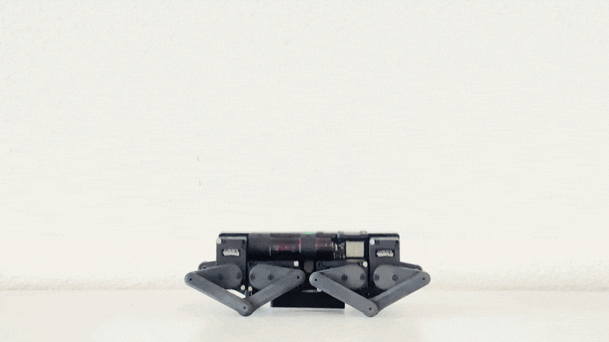
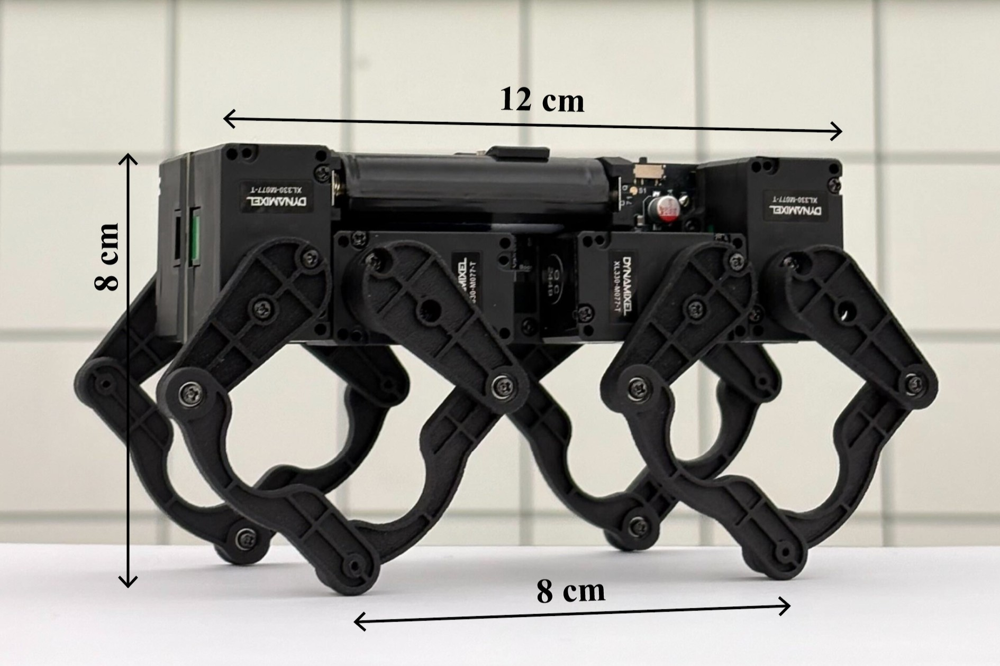
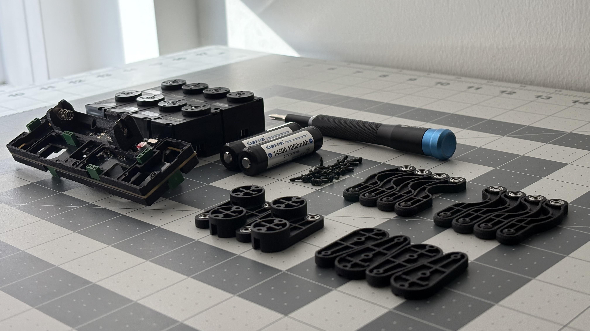

# Q8bot Quadruped

**Looking for hardware files? CAD, STL, and PCB files can be found in the [Releases](https://github.com/EricYufengWu/q8bot/releases)
 section of this repository.**

## 🚀 **Interested in the next generation of Q8bot?**

Q8botOne, a complete upgrade to the original Q8bot, is now launched as a crowdfunding project on **Crowd Supply**:
https://www.crowdsupply.com/zerowire-robotics/q8botone

  

**For a full history of updates, please go to [UPDATES.md](UPDATES.md)**

## What is Q8bot?

Q8bot is a miniature quadruped robot with the size and weight comparable to a modern smartphone. This robot is capable of dynamic movements like walking, trotting, bounding, jumping, and more. It also has NO WIRES AND CABLES - everything is directly plugged into the center PCB, greatly reducing complexity, weight, and cost. The current **[Bill of Materials (BOM)](https://docs.google.com/spreadsheets/d/1M1K_Dghia-Mn2t4RStW8juN6r4e3I3OBy6M_fPFHzs8/edit?usp=sharing)**, without optimization, ranges between $300 - $400 depending on the listed options. 

  
  

## Featured Media & Demos
Q8bot's capabilities: [IROS Video](https://youtu.be/0dk7lYoITQw) 

Detailed building process: [YouTube Video](https://youtu.be/YJDc1xAhaOI)

Q8bot is lucky to be featured in a number of blog posts:
- Hackaday: https://hackaday.com/2024/10/29/little-quadruped-has-pcb-spine-and-no-wiring/#comments
- Hackster.io: https://www.hackster.io/news/a-step-up-for-diy-robotics-8b04a2320861?f=1
- Interesting Engineering: https://interestingengineering.com/innovation/palm-sized-quadruped-robot-redefines-design

## Publications
- Design: [IROS2025 via IEEE Xplore](https://ieeexplore.ieee.org/abstract/document/11246322), [arXiv](https://arxiv.org/abs/2508.01149).
- Control & Data Acquisition: [UR2025 via IEEE Xplore](https://ieeexplore.ieee.org/abstract/document/11078123/).

## Open Source Information
Q8bot is 100% open source: In this repository, you will find everything you need - STEP, STL, Gerber, Schematics, bill of materials (BOM), instructions, and more - to build your own version. 

**You can now ordered the fully-assembled PCB via PCBWay!** This [project page](https://www.pcbway.com/project/shareproject/Q8bot_PCB_Robot_dfa65114.html) contains all of the assembly-related files (BOM, centroid, etc.) and simplifies the ordering process.

    

Building a Q8bot yourself is perfect for robotics education, swarm robotics research, or simply as a fun engineering project. If you have any questions, feel free to reach out and I will try my best to help. **If you have built your own Q8bot, please consider sending photos or videos to me! I would love to feature your creation here publically with your permission!**

If you have any questions, you can always open a GitHub issue here, or send me a message at yufeng.wu0902@gmail.com.

## Building Instruction
The building instructions have moved to a dedicated folder:

[Sourcing Components](docs/instructions/sourcing_components.md)

[Assembling the Robot](docs/instructions/robot_assembly.md)

[Software Setup](docs/instructions/software_setup.md)

## Note on Project Ownership
Q8bot is currently considered as a project at the [UCLA Robotics and Mechanisms Lab (RoMeLa)](https://www.romela.org/). I am grateful for the support from Dr. Dennis Hong and fellow RoMeLa members in helping publish my work as an academic research paper.

That said, since Q8bot was originally conceived and developed independently prior to my time at UCLA, I will retain full ownership of the original design after graduation. Given the project’s open-source nature, RoMeLa will have the freedom to continue developing, modifying, and publishing research based on the platform. A derived successor design is currently under development and will be owned by RoMeLa.