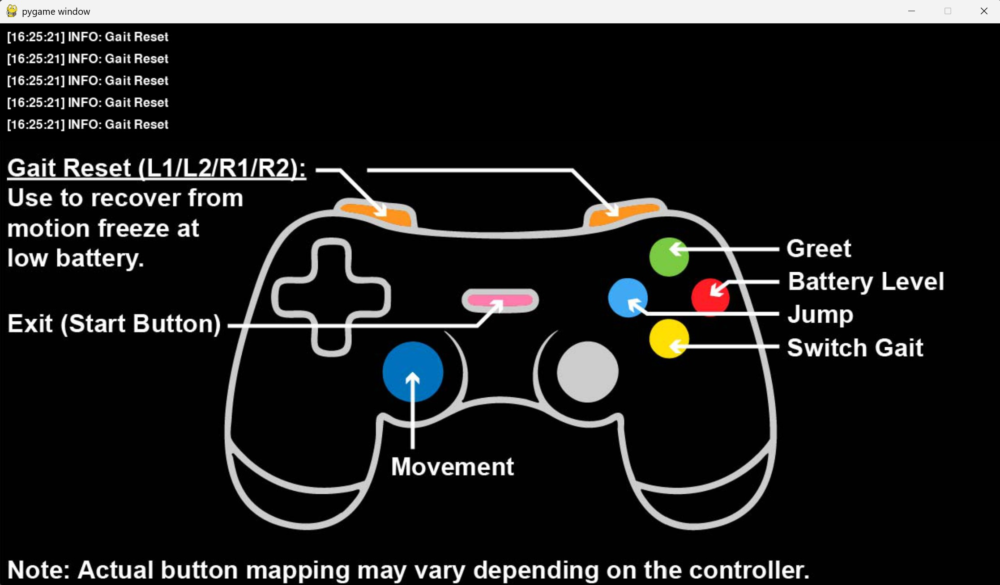
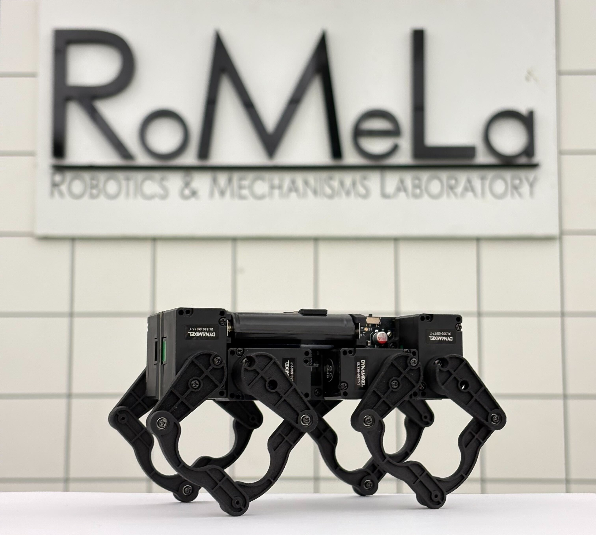

# Q8bot Project Updates

**[BACK TO PROJECT README](README.md)**

### 01/01/2026 Paper Publication Update

🎉 **The Q8bot design paper is now available on IEEE Xplore.** Please see the publication section for links.

For research or projects related to Q8bot, please consider citing our work! Citations help support continued open-source development and help the project reach a wider audience.

### 11/06/2025 Python Controller Improvements

I've published python-tool v1.2.0 in Releases. It adds support for common joysticks, including Xbox controllers and Nintendo Switch Joy‑Con. Note that you'll still need a laptop and a wireless dongle to run Q8bot—the joystick provides more granular movement control than the discrete WASD keyboard commands.

The updated python-tool also has a refreshed pygame interface that is no longer a blank screen :D.

  
  

### 10/11/2025 Repository Update
Repository Restructuring is complete! 

**TL;DR:** Clone the repository for all software-related setup, and go to [the latest release](https://github.com/EricYufengWu/q8bot/releases/tag/v1.1.0) to download the compressed file containing hardware source files (STLs, Gerbers, CAD). Go to the bottom of this page for building instructions.

### 10/09/2025 Repository Re-Organization
I am making major updates to the repository's structure to make it more organized and easy to navigate. I appreciate your patience as things may get a bit messy for a short while! Major changes include:
- Move the current main branch to a protected, legacy branch to help with transition
- Retrospectively publishing release bundles containing legacy software and hardware packages for those who may need them.
- Moving hardware source files (STEP, STL, Gerber, etc.) out of the main repository and including them only as part of releases — done to save space and keep Git tracking clean.

In the meantime, I’m also making major updates to the software stack. Please stay tuned for updated firmware and setup instructions!

### 07/18/2025 Publication Update
My paper on Q8bot's remote gait computation and data collection architecture was published on IEEE Xplore: https://ieeexplore.ieee.org/abstract/document/11078123/

### 04/28/2025 Media Feature
Q8bot was recently featured in a [tour video](https://youtu.be/FAo-BCnxW9A?si=LB-HlDlHGtaq-xd7&t=1208) by UnrealScience, a famous Korean science Youtube channel.

### 03/03/2025 Project Update
 Update: Q8bot is now a research project at the [UCLA Robotics and Mechanisms Lab (RoMeLa)](https://www.romela.org/). The open-source nature of this project remains unchanged. We are working on an improved version of this platform and will potentially release it under a different name. Stay tuned!** 

### 10/17/2024 Thanks for Checking out my Project!
After releasing the first "polished" video on [YouTube](https://youtu.be/YJDc1xAhaOI?si=9ayzV78TSruOL7K_), I am surprised that so many of you are checking out my project and this repository. Thank you all for the interest, and I will try my best to improve the platform in the future!